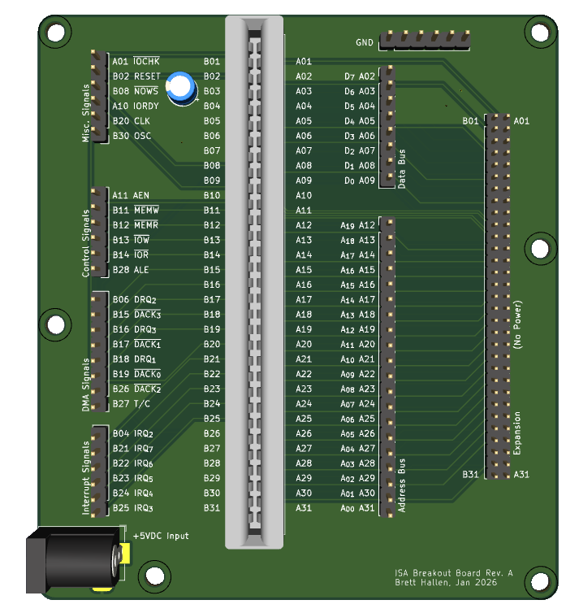
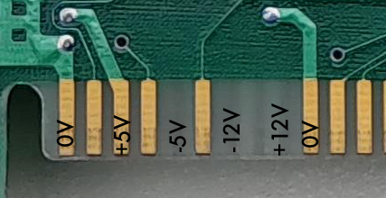

# ISA Breakout Board for Logic Analysers
Breakout board to simplify connecting an ISA card to a logic analyser. 

I'll be looking at a Multitech MPF-PC/500 CPU card which has no documentation (that I've been able to find) and apparently is designed for a "custom" ISA backplane. 

Thus I thought it might be useful to have an ISA backplane with all of the signals broken out to pin headers. 

This particular design only provides for +5VDC as that appears to be all that the Multitech CPU card requires - the -5V and ±12V pins are not connected. 

I've also included a 2x31 pin header (2mm pin pitch) to connect to the ISA backplane designed for the Book 8088 computer so that additional cards, like video & storage, might be added. 

## Status
- 28/Jan/2026: initial design, untested.
